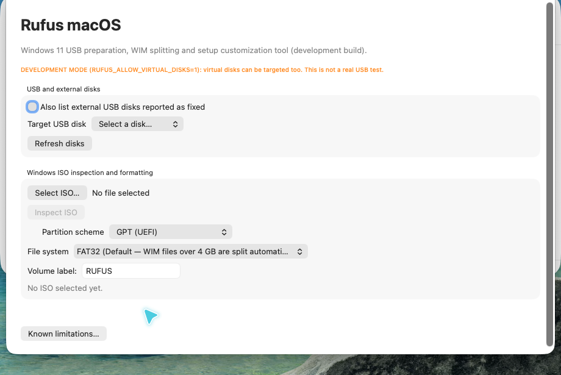
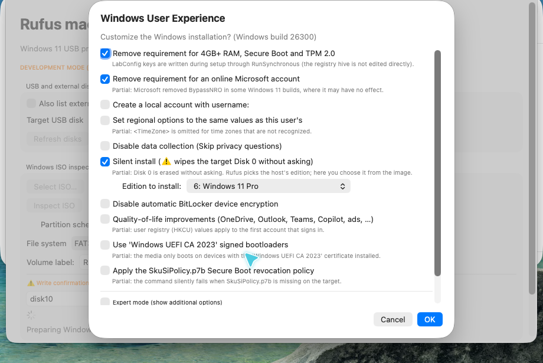
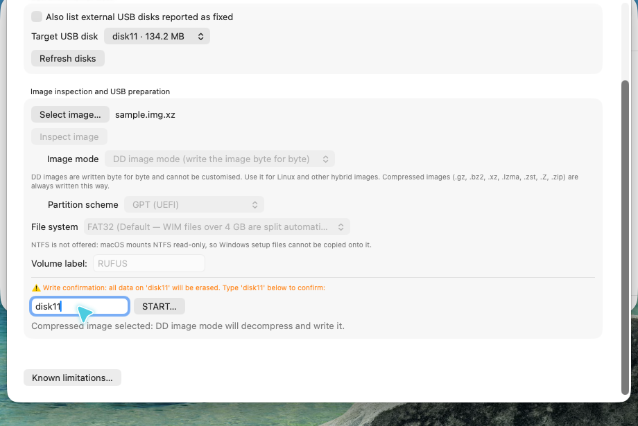

# Rufus macOS — experimental native port

A native SwiftUI port of selected [Rufus](https://github.com/pbatard/rufus) workflows for macOS: prepare Windows installation media, customize setup, and write raw or compressed disk images.

> **Experimental preview, not a stable release.** Disk writes erase data. Recorded end-to-end tests used disposable disk images in a macOS Cua Space—not physical USB drives. The app is not notarized. This is an independent port, not an official macOS release or an endorsed product of the upstream Rufus project.

**Based on:** Rufus **4.16.2430 development snapshot**, upstream commit [`2a8ecf282801668f70945f99eb1f78a979ded5aa`](https://github.com/pbatard/rufus/commit/2a8ecf282801668f70945f99eb1f78a979ded5aa), dated 2026-10-28. This is not a tagged Rufus 4.16 release. See [provenance and resource hashes](PROVENANCE.md).

## What works today

| Workflow | Current scope |
| --- | --- |
| Native English interface | Disk selection, image inspection, typed erase confirmation and progress |
| Windows file-copy media | GPT/MBR, FAT32/exFAT, oversized install WIM splitting using wimlib |
| Windows setup customization | Hardware-check bypass, account/privacy/regional choices, BitLocker settings, edition selection and silent-install answer files |
| Raw DD images | Byte-for-byte whole-disk writes with read-back comparison |
| Compressed DD images | gzip, bzip2, xz, zstd and single-member ZIP tested; LZMA and `.Z` command paths present but not separately tested |
| Safety checks | Conservative inventory, identity revalidation, source-on-target rejection and mount blocking during raw writes |

Windows options have been verified at the generated-file level, **not by a complete Windows installation**. Silent install can wipe **Disk 0 on the destination computer without asking**. Read the [safety guide](macos/docs/SAFETY.md) before use.

## Screenshots

The screenshots below show the real development build in a disposable macOS VM. Virtual-device identifiers are test targets, not instructions to select a disk on your Mac.

### Native interface



### Windows User Experience



### Compressed-image DD mode



## Build and check

Requirements: macOS 13+, Swift 5.9+ / Xcode Command Line Tools, C compiler, Make and `pkg-config`. Network access is needed for pinned helper source downloads. Recorded builds were Apple silicon; Intel is not validated.

```sh
cd macos
bash scripts/build-wimlib.sh
bash scripts/build-compressors.sh
bash scripts/check.sh
bash scripts/build-app.sh
open .build/RufusMac.app
```

The helper builds stay under ignored `.deps/`; the app is created under ignored `.build/`. No helper is installed system-wide. The app bundle uses an ad-hoc development signature, not Developer ID signing or notarization. Building Swift targets alone is not enough to assemble the full app.

See [implementation and build notes](macos/README.md), [third-party notices](THIRD_PARTY_NOTICES.md), and the [publishing checklist](macos/docs/PUBLISHING.md).

The publication tree was rebuilt from a fresh source snapshot: all 34 normal check groups passed and the ad-hoc app signature verified. [Preparation record and log](macos/docs/REPOSITORY-PREPARATION.md).

## What is not ready

- No recorded physical USB write or complete Windows installation validation.
- No NTFS media creation: the tested native macOS NTFS driver is read-only. No macFUSE dependency is installed or required by this preview.
- No Windows To Go, persistence, Linux file-copy bootloader installation, FreeDOS, VHD/VHDX/FFU conversion or ext/UDF/ReFS formatting.
- No offline Windows registry-hive editing; supported bypass settings use the answer-file fallback.
- No guarantee that every upstream Windows Rufus option, image, firmware or Secure Boot configuration works.

## Repository layout

```text
macos/       Swift application, core, checks, scripts and public documentation
res/setup/  Required upstream Windows setup wrappers and corresponding source
res/uefi/   Required upstream boot image and its provenance notice
res/icons/  Setup-wrapper icon and original licensing notice only
```

Windows-only application sources and build infrastructure are removed from the current tree. Upstream ancestry is retained; this is a focused derivative, not a history rewrite. Local development transcripts, ISOs and build outputs are not publication content.

## Verification record

The [verification summary](macos/docs/VERIFICATION.md) links the recorded checks and explains their limits. The compressed-image run finished with `DD write finished: 1 MB written, verified against the image.` An independent SHA-256 comparison of the decompressed fixture and device bytes matched. A previous QEMU smoke test reached Windows Setup, not a completed installation.

## License and attribution

The port is derived from Rufus and licensed **GPL-3.0-or-later**; retain [LICENSE.txt](LICENSE.txt), upstream attribution and the [component notices](THIRD_PARTY_NOTICES.md). Bundled resources retain their own notices and source obligations. Review those obligations before distributing binaries.
