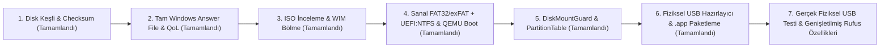

# Rufus macOS Portu — Görev ve İlerleme Takibi (`Task.md`)

**Hedef:** Upstream Rufus (`commit 2a8ecf282801668f70945f99eb1f78a979ded5aa`, GPLv3) kaynak kodunun tüm belgelenmiş özellikleriyle yerel (native) bir macOS uygulamasına taşınması. Kullanıcının birincil ihtiyacı olan **Windows 11 kurulum USB’si hazırlama ve Windows Kurulum Özelleştirmeleri (WUE / Bloatware & QoL temizliği)** ilk aşamaların merkezinde yer alırken, nihai hedef tam Rufus özellik eşitliğidir (feature parity).

**Referans Belgeler:**
- Tasarım Dokümanı: [`../docs/superpowers/specs/2026-10-29-rufus-macos-design.md`](file:///Users/karaketir16/Documents/ChatGPT/Chat/docs/superpowers/specs/2026-10-29-rufus-macos-design.md)
- Uygulama Planı: [`../docs/superpowers/plans/2026-10-29-rufus-macos.md`](file:///Users/karaketir16/Documents/ChatGPT/Chat/docs/superpowers/plans/2026-10-29-rufus-macos.md)
- macOS Port Klasörü: [`macos/`](file:///Users/karaketir16/Documents/ChatGPT/Chat/rufus-source/macos)

---

## 1. Neler Planlandı? (Kapsam ve Mimari)

Upstream Rufus (`src/drive.c`, `src/format.c`, `src/iso.c`, `src/wue.c`, `src/ui.c` vb.) doğrudan Win32 API’lerine (`CreateFile`, `DeviceIoControl`, `SetupDi*`) bağlı olduğu için doğrudan derleme yerine **modüler bir macOS mimarisi** planlandı:

1. **Güvenli Disk Algılama ve Kimlik Doğrulama** (`src/dev.c`, `src/drive.c` karşılığı)
   - Yalnızca harici/çıkarılabilir fiziksel ana disklerin (`whole disk`) hedeflenmesi; dahili sistem disklerinin kesin olarak dışlanması.
   - Yazma işleminden hemen önce disk kimliğinin (BSD adı, kapasite ve IOKit `registryEntryID`) yeniden doğrulanması.
2. **Windows Kurulum Özelleştirmeleri (`autounattend.xml` / WUE)** (`src/wue.c` karşılığı)
   - TPM 2.0, Secure Boot ve RAM sınırı kontrollerini aşma.
   - Çevrimiçi Microsoft hesabı zorunluluğunu (`BypassNRO`) aşma ve gizlilik ekranlarını (`ProtectYourPC`) kapatma.
   - Rufus **QoL (Quality of Life)** geliştirmeleri: OneDrive, Outlook ve Teams’in kaldırılması; Başlat menüsü reklamları/önerileri, Copilot, Bing araması, Widget/Haber akışı, Hızlı Başlatma (`Hiberboot`) ve klasik sağ tık menüsü ayarları.
   - Yerel yönetici hesabı oluşturma ve BitLocker / otomatik cihaz şifrelemesini devre dışı bırakma.
   - Diğer upstream seçenekleri: dahili diskleri çevrimdışı bırakma (`SanPolicy=4`), S Mode kapatma, `SkuSiPolicy.p7b` politikası, sessiz kurulum (`silentInstall`) ve bölge/dil/saat dilimi ayarlarını kopyalama.
3. **ISO İnceleme, WIM Bölme ve Medya Hazırlama** (`src/iso.c`, `src/wimlib` karşılığı)
   - ISO içeriğinin incelenmesi, UEFI bootloader tespiti ve FAT32 tek dosya sınırını (4 GB) aşan `sources/install.wim` dosyalarının tespiti.
   - `wimlib-imagex` ile büyük `install.wim` dosyalarının FAT32 uyumlu `.swm` parçalarına bölünmesi.
4. **Disk Biçimlendirme, Ham Görüntü (Raw Image) ve Fiziksel USB Yazma** (`src/format.c`, `src/drive.c`, `src/vhd.c` karşılığı)
   - MBR/GPT bölümleme, FAT32/exFAT ve diğer dosya sistemleri (NTFS, UDF, ReFS, ext2/3/4) + `UEFI:NTFS` önyükleyici bölümü.
   - Disk Arbitration ile hedef diskin işlem boyunca otomatik bağlanmasının (auto-mount) engellenmesi, kimlik doğrulaması ve güvenli yazma/doğrulama.
5. **Diğer Tam Port Özellikleri**
   - Önyükleme modları (BIOS/UEFI, FreeDOS, Syslinux, GRUB, UEFI:NTFS).
   - Linux kalıcı bölüm (persistence), Windows To Go, VHD/VHDX/FFU/DD imaj işlemleri, bozuk blok (bad blocks) ve sahte kapasite testleri, resmi ISO indirme betikleri, çoklu dil (localization) ve yerel SwiftUI arayüzü.

---

## 2. Neler Yapıldı ve Nasıl Yapıldı?

Geliştirme `codex/macos-port` dalında, [`macos/`](file:///Users/karaketir16/Documents/ChatGPT/Chat/rufus-source/macos) altında Swift Package Manager (`RufusCore` kütüphanesi + `RufusMacApp` çalıştırılabilir uygulaması) kullanılarak yapıldı. Sistemde tam Xcode kurulu olmadığı için (`XCTest` yerine) özel bir doğrulama koşucusu ([`macos/Checks/main.swift`](file:///Users/karaketir16/Documents/ChatGPT/Chat/rufus-source/macos/Checks/main.swift)) ve Python entegrasyon betikleriyle TDD (Test-Driven Development) uygulandı.

### A. Salt Okunur Disk Keşfi ve Kimlik Doğrulama
- **Dosyalar:**
  - [`macos/Sources/RufusCore/DiskInventory.swift`](file:///Users/karaketir16/Documents/ChatGPT/Chat/rufus-source/macos/Sources/RufusCore/DiskInventory.swift)
  - [`macos/Sources/RufusCore/DiskIdentity.swift`](file:///Users/karaketir16/Documents/ChatGPT/Chat/rufus-source/macos/Sources/RufusCore/DiskIdentity.swift)
- **Nasıl Yapıldı?**
  - `/usr/sbin/diskutil list -plist external physical` ve `diskutil info -plist <diskN>` çıktıları `PropertyListSerialization` ile ayrıştırıldı (kabuk/shell interpolasyonu kullanılmadan doğrudan `Process` argümanlarıyla).
  - **Fail-closed filtreleme:** Yalnızca `^disk[0-9]+$` desenine uyan, `WholeDisk == true`, `Internal == false`, `VirtualOrPhysical == "Physical"` ve `TotalSize > 0` olan diskler kabul edildi.
  - macOS bazı USB bellekleri/diskleri `RemovableMedia == false` olarak raporladığı için `includeExternalUSBDisks` seçeneği eklendi; bu seçenek yalnızca `BusProtocol == "USB"` ve `Ejectable == true` olan harici diskleri dahil eder (Thunderbolt vb. sabit diskleri reddeder).
  - **IOKit Kimlik Enstantanesi (`DiskIdentity.Snapshot`):** Disk numaralarının (`disk4` vb.) çıkarılıp takıldığında başka bir diske atanması riskine karşı `IOBSDNameMatching` ve `IORegistryEntryGetRegistryEntryID` kullanılarak aygıtın çekirdek kayıt numarası (`registryEntryID`) okundu. `diskutil` çağrısının öncesinde ve sonrasında `registryEntryID` karşılaştırılarak yarış durumu (race condition) kontrolü eklendi.

### B. Özet (Checksum) Hesaplama
- **Dosya:** [`macos/Sources/RufusCore/Checksum.swift`](file:///Users/karaketir16/Documents/ChatGPT/Chat/rufus-source/macos/Sources/RufusCore/Checksum.swift)
- **Nasıl Yapıldı?**
  - macOS `CryptoKit` (`Insecure.MD5`, `Insecure.SHA1`, `SHA256`, `SHA512`) kullanılarak dosyaları belleğe tam yüklemeden 1 MiB’lık bloklar halinde (`FileHandle.read(upToCount: 1024 * 1024)`) okuyan akış (streaming) tabanlı özet hesaplayıcı yazıldı.
  - Standart test vektörleri, boş dosya ve çoklu blok (2 MB) dosyalarla doğrulandı.

### C. Windows Kurulum Özelleştirmeleri (`autounattend.xml`) — Tam Upstream `wue.c` Eşitliği
- **Dosya:** [`macos/Sources/RufusCore/WindowsAnswerFile.swift`](file:///Users/karaketir16/Documents/ChatGPT/Chat/rufus-source/macos/Sources/RufusCore/WindowsAnswerFile.swift)
- **Nasıl Yapıldı?**
  - Upstream [`src/wue.c`](file:///Users/karaketir16/Documents/ChatGPT/Chat/rufus-source/src/wue.c) (`CreateUnattendXml`) içindeki XML yapısı, kurulum aşamaları (`windowsPE`, `offlineServicing`, `specialize`, `oobeSystem`) ve komut sıralamaları birebir incelenerek tam eşitlikle Swift’e taşındı:
    - **`windowsPE` aşaması (`bypassHardware` & `silentInstall`):**
      - `HKLM\SYSTEM\Setup\LabConfig` altına `BypassTPMCheck`, `BypassSecureBootCheck`, `BypassRAMCheck` (`REG_DWORD = 1`) ekleyen `RunSynchronousCommand` girdileri.
      - `<UserData><AcceptEula>true</AcceptEula><ProductKey><Key /></ProductKey></UserData>` bloğu (`src/wue.c:1118-1124`).
      - **`silentInstall` (`SilentInstall`):** `Microsoft-Windows-International-Core-WinPE` altında kurulum dili (`UILanguage`, `SystemLocale`, `UserLocale`, `InputLocale`) ve `Microsoft-Windows-Setup` altında Disk 0’ı otomatik GPT olarak biçimlendiren `<DiskConfiguration>` (`300 MB EFI + 128 MB MSR + RUFUS_BOOT Birincil Bölüm`, `ModifyPartition` / `Format=NTFS`) ve `<ImageInstall><OSImage><InstallFrom><MetaData>/IMAGE/INDEX` yapılandırması (`src/wue.c:1058-1116`).
    - **`offlineServicing` aşaması (`offlineInternalDrives` & `forceSMode`):**
      - `offlineInternalDrives`: `Microsoft-Windows-PartitionManager` bileşeni altında `<SanPolicy>4</SanPolicy>` ile dahili diskleri kurulum sırasında çevrimdışı tutma (`src/wue.c:1132-1138`).
      - `forceSMode`: `Microsoft-Windows-CodeIntegrity` altında `<SkuPolicyRequired>1</SkuPolicyRequired>` (`src/wue.c:1139-1144`). Upstream’de olduğu gibi `forceSMode` ile `bypassOnlineAccount` birlikte seçildiğinde çelişki hatası (`conflictingOptions`) fırlatılır.
    - **`specialize` aşaması (`bypassOnlineAccount`, `removeBundledApps` / `qualityOfLife`):**
      - `HKLM\Software\Microsoft\Windows\CurrentVersion\OOBE\BypassNRO = 1`.
      - OneDrive politikası (`DisableFileSyncNGSC = 1`), `System32`/`SysWOW64` altındaki `OneDriveSetup.exe` dosyalarının PowerShell ile silinmesi, `*Outlook*` ve `*Teams*` provizyonlu ve kurulu Appx paketlerinin kaldırılması.
    - **`oobeSystem` aşaması:**
      - `disablePrivacyPrompts` & `silentInstall`: `<HideEULAPage>true</HideEULAPage><ProtectYourPC>3</ProtectYourPC>` ve sessiz kurulumda `<HideOnlineAccountScreens>true</HideOnlineAccountScreens><HideWirelessSetupInOOBE>true</HideWirelessSetupInOOBE>`.
      - `regionalOptions`: `<TimeZone>` ve `Microsoft-Windows-International-Core` (`InputLocale`, `SystemLocale`, `UILanguage`, `UILanguageFallback`, `UserLocale`) ayarlarının kopyalanması (`src/wue.c:1197-1208`, `1294-1305`).
      - `localAccount`: Upstream Rufus’un kullanıcı adı doğrulaması (maks. 20 UTF-16 karakter, yasaklı karakterler, ayrılmış Windows hesap adları `Administrator`, `Guest`, `NUL` vb. kontrolü) uygulandı. Boş parolalı (`UABhAHMAcwB3AG8AcgBkAA==`) yerel yönetici hesabı ve ilk oturumda parola değiştirmeyi zorunlu kılan (`net user "<ad>" /logonpasswordchg:yes`, `net accounts /maxpwage:unlimited`) komutlar eklendi.
      - `applySkuSiPolicy`: `MountVol` ile EFI Sistem Bölümünü bağlayıp `EFI\Microsoft\Boot\SkuSiPolicy.p7b` politikasını kopyalayan `<SynchronousCommand>` (`src/wue.c:1239-1244`).
      - `qualityOfLife`: Upstream `wue.c`’deki 15 kayıt defteri ayarı (`HiberbootEnabled`, `ShowCopilotButton`, `TurnOffWindowsCopilot`, `SearchboxTaskbarMode`, `DisableWindowsConsumerFeatures`, `SystemPaneSuggestionsEnabled`, `BingSearchEnabled`, `PreventDeviceMetadataFromNetwork`, `AllowNewsAndInterests`, `EnableFeeds`, `ConfigureChatAutoInstall`, `DisableCloudOptimizedContent`, `HideFirstRunExperience`, `Start_Layout`), Başlat menüsü `VisiblePlaces` ikili (Base64) değeri ve Windows 11 klasik sağ tık menüsü CLSID (`{86ca1aa0-34aa-4e8b-a509-50c905bae2a2}`) komutu `<FirstLogonCommands>` altına eklendi.
      - `disableDeviceEncryption`: `Microsoft-Windows-SecureStartup-FilterDriver` (`PreventDeviceEncryption = true`), `Microsoft-Windows-EnhancedStorage-Adm` (`TCGSecurityActivationDisabled = 1`) ve Windows 24H2+ için `Microsoft-Windows-DeviceGuard-Unattend` (`DisableEncryptedDiskProvisioning = true`, `src/wue.c:1306-1312`) bileşenleri eklendi.
  - **Düzeltme (önceki kayıt yanlıştı):** Daha önce yanıt dosyasının hem medya köküne hem `Panther`e yazıldığı ve bunun `src/wue.c:1321-1351` ile birebir uyumlu olduğu yazılmıştı. Bu doğru değildi; upstream davranışı Bölüm **I**'de ayrıntılı olarak anlatılan `ApplyWindowsCustomization` akışıdır (windowsPE varsa `boot.wim` içine `Autounattend.xml`, yoksa `sources\$OEM$\$$\Panther\unattend.xml`). Kod buna göre değiştirildi.

### D. ISO İnceleme, `wimlib` Derlemesi ve WIM Bölme
- **Dosyalar:**
  - [`macos/Sources/RufusCore/WindowsMediaInspector.swift`](file:///Users/karaketir16/Documents/ChatGPT/Chat/rufus-source/macos/Sources/RufusCore/WindowsMediaInspector.swift)
  - [`macos/Sources/RufusCore/ISOInspection.swift`](file:///Users/karaketir16/Documents/ChatGPT/Chat/rufus-source/macos/Sources/RufusCore/ISOInspection.swift)
  - [`macos/Sources/RufusCore/WIMSplitter.swift`](file:///Users/karaketir16/Documents/ChatGPT/Chat/rufus-source/macos/Sources/RufusCore/WIMSplitter.swift)
  - [`macos/Sources/RufusCore/WindowsMediaStager.swift`](file:///Users/karaketir16/Documents/ChatGPT/Chat/rufus-source/macos/Sources/RufusCore/WindowsMediaStager.swift)
  - [`macos/Sources/RufusCore/BundledTools.swift`](file:///Users/karaketir16/Documents/ChatGPT/Chat/rufus-source/macos/Sources/RufusCore/BundledTools.swift)
  - [`macos/scripts/build-wimlib.sh`](file:///Users/karaketir16/Documents/ChatGPT/Chat/rufus-source/macos/scripts/build-wimlib.sh)
- **Nasıl Yapıldı?**
  - **Dizin/ISO İnceleme (`WindowsMediaInspector`):** `realpath` ile kanonik yol doğrulaması yapılarak sembolik linkler (symlink saldırıları/hataları) ve özel dosya tipleri reddedildi. `efi/boot/bootx64.efi`, `bootaa64.efi`, `bootia32.efi`, `sources/boot.wim`, `sources/install.{wim,esd,swm}` ve FAT32 sınırını (`4_294_967_295` bayt) aşan dosyalar tespit edildi.
  - **Salt Okunur Bağlama (`ISOInspection`):** `hdiutil attach -readonly -nobrowse -mountpoint <geçici_dizin>` ile ISO bağlanıp incelendikten sonra `hdiutil detach` ile ayrıldı ve geçici bağlama noktası temizlendi.
  - **Tekrar Üretilebilir `wimlib` Derlemesi ve Paketleme (`build-wimlib.sh` & `BundledTools`):** `wimlib-1.14.5.tar.gz` resmi kaynaktan indirilip SHA-256 özeti (`84221a3abd...`) doğrulandıktan sonra proje içi `macos/.deps/wimlib-1.14.5/bin/wimlib-imagex` konumuna statik olarak derlendi. `BundledTools` modülü hem `.app/Contents/Resources` içinden hem de geliştirme ortamından `wimlib-imagex` ve `uefi-ntfs.img` dosyalarını otomatik bulacak şekilde yazıldı.
  - **WIM Bölme ve Hazırlama (`WIMSplitter` & `WindowsMediaStager`):** `install.wim` dosyası 4 GB’ı aştığında `wimlib-imagex split <install.wim> <hedef/install.swm> 3800 --check` çalıştırılarak geçici dizinde 3800 MiB’lık `.swm` parçalarına bölündü, her parçanın 4 GB altında olduğu doğrulandı ve diğer ISO dosyalarıyla birlikte hedef dizine/bölüme kopyalandı. Yeni biçimlendirilmiş macOS disk bölümlerinde çekirdeğin otomatik oluşturduğu `.fseventsd` ve `.Spotlight-V100` dizinlerinin kopyalamayı engellememesi için `allowVolumeMetadata: true` desteği eklendi.

### E. Sanal Medya Oluşturma ve Gerçek Windows 11 ISO + QEMU UEFI Doğrulaması
- **Dosyalar:**
  - [`macos/Sources/RufusCore/VirtualMediaBuilder.swift`](file:///Users/karaketir16/Documents/ChatGPT/Chat/rufus-source/macos/Sources/RufusCore/VirtualMediaBuilder.swift)
  - [`macos/scripts/check-virtual-fat.py`](file:///Users/karaketir16/Documents/ChatGPT/Chat/rufus-source/macos/scripts/check-virtual-fat.py)
  - [`macos/docs/verification/windows-setup-qemu.png`](file:///Users/karaketir16/Documents/ChatGPT/Chat/rufus-source/macos/docs/verification/windows-setup-qemu.png)
- **Nasıl Yapıldı?**
  - `VirtualMediaBuilder.create`: `hdiutil create -size <N>g -fs MS-DOS -volname RUFUS -type SPARSE -layout GPTSPUD` ile GPT bölümlü ve FAT32 dosya sistemli sanal disk oluşturup bağlar, `diskutil info` ile dosya sisteminin `MS-DOS FAT32` olduğunu doğrular, **macOS’un `GPTSPUD` düzeninde otomatik eklediği 200 MB’lık `EFI` Sistem Bölümünü (`C12A7328-F81F-11D2-BA4B-00A0C93EC93B`) `diskutil eraseVolume free none <efiSlice>` ile kaldırır** (Windows Setup’ın iki adet ESP gördüğünde `"Copying Windows Files"` aşamasında hata vermesini önler — bkz. `src/drive.c:2512`), ISO içeriğini ve `autounattend.xml` dosyasını yazar, ardından görüntüyü ayırır.
  - `VirtualMediaBuilder.exportRaw`: Oluşturulan `.sparseimage` dosyasını `hdiutil convert -format UDRW` ile ham `.img` dosyasına çevirir, ilk 17 KiB’da koruyucu MBR (`0x55AA`), GPT (`EFI PART`) imzalarını ve GPT tablosunda çakışan bir `EFI System Partition` kalmadığını doğrular.
  - **Gerçek Windows 11 ISO ve QEMU Testi:** `~/Downloads/Windows11_Client_x64_en-us_26300_9457.iso` (8.4 GiB) kullanılarak 16 GiB GPT/FAT32 sanal kurulum medyası üretildi, `install.wim` `.swm` parçalarına bölündü ve `wimlib-imagex verify` ile doğrulandı. Ardından ham imaja dönüştürülüp `qemu-system-x86_64` (QEMU 11.1.3, `q35`, `-cpu max`, OVMF `edk2-x86_64-code.fd`, `usb-storage`) üzerinde UEFI’den başlatıldı ve **Windows 11 Kurulum dil seçimi ekranına ulaştığı** ekran görüntüsüyle ([`windows-setup-qemu.png`](file:///Users/karaketir16/Documents/ChatGPT/Chat/rufus-source/macos/docs/verification/windows-setup-qemu.png)) kanıtlandı.

### F. Ham Görüntü Kopyalama/Doğrulama, Disk Arbitration Koruması (`DiskMountGuard`) ve Sanal Blok Aygıt Yazıcısı
- **Dosyalar:**
  - [`macos/Sources/RufusCore/RawImage.swift`](file:///Users/karaketir16/Documents/ChatGPT/Chat/rufus-source/macos/Sources/RufusCore/RawImage.swift)
  - [`macos/Sources/RufusCore/DiskMountGuard.swift`](file:///Users/karaketir16/Documents/ChatGPT/Chat/rufus-source/macos/Sources/RufusCore/DiskMountGuard.swift)
  - [`macos/Sources/RufusCore/VirtualDeviceWriter.swift`](file:///Users/karaketir16/Documents/ChatGPT/Chat/rufus-source/macos/Sources/RufusCore/VirtualDeviceWriter.swift)
  - [`macos/scripts/check-virtual-device.py`](file:///Users/karaketir16/Documents/ChatGPT/Chat/rufus-source/macos/scripts/check-virtual-device.py)
- **Nasıl Yapıldı?**
  - **`DiskArbitration` Zaman Aşımı Sorununun Tespiti ve Çözümü (`DiskMountGuard`):**
    - Önceki oturumda `DADiskClaim` çağrısının `hdiutil` sanal disklerinde neden zaman aşımına uğradığı teşhis edildi: macOS’ta `diskimagesiod` servisi `hdiutil` ile bağlanan her sanal diski zaten sahiplenmektedir (`DADiskIsClaimed(disk) == true`), buna karşın fiziksel disklerde `DADiskIsClaimed == false`’tur. Ayrıca `kDAReturnBusy` (`-119930878`) negatif bir tamsayı olduğu için Swift’te `UInt32(kDAReturnBusy)` dönüşümü çalışma zamanı hatasına (trap) yol açıyordu.
    - Çözüm olarak [`DiskMountGuard.withUnmountedGuard`](file:///Users/karaketir16/Documents/ChatGPT/Chat/rufus-source/macos/Sources/RufusCore/DiskMountGuard.swift) geliştirildi: Hedef ana disk (`diskN`) ve alt bölümleri (`diskNsM`) için `DARegisterDiskMountApprovalCallback` kaydedilerek yazma/biçimlendirme süresince gelen tüm bağlama (mount) istekleri `DADissenterCreate(kCFAllocatorDefault, DAReturn(kDAReturnBusy), ...)` ile reddedilir; ardından `DADiskUnmount(..., kDADiskUnmountOptionWhole, ...)` ile tüm bölümler ayrılır ve işlem başında/sonunda IOKit `registryEntryID` değişmezliği kontrol edilir.
  - `RawImage.copy` & `RawImage.verify`: `O_NOFOLLOW | O_EXCL` bayraklarıyla 1 MiB bloklarla kopyalama ve bayt bayt karşılaştırma yapar.
  - `VirtualDeviceWriter`: `DiskMountGuard` koruması altında bağlanmamış `hdiutil` sanal diskini (`/dev/rdiskN`) `O_EXLOCK` ile açar; `hdiutil info -plist`, `diskutil info -plist`, `st_rdev` ve IOKit `registryID` değerlerini doğrular ve yazılan veriyi `/dev/rdiskN` üzerinden geri okuyarak (`VirtualDeviceWriter.verify`) teyit eder.

### G. Rufus Uyumlu GPT/MBR Bölüm Tablosu Üreticisi (`PartitionTable`) ve Sanal Disk Biçimlendirici (`VirtualDiskFormatter`)
- **Dosyalar:**
  - [`macos/Sources/RufusCore/PartitionTable.swift`](file:///Users/karaketir16/Documents/ChatGPT/Chat/rufus-source/macos/Sources/RufusCore/PartitionTable.swift)
  - [`macos/Sources/RufusCore/VirtualDiskFormatter.swift`](file:///Users/karaketir16/Documents/ChatGPT/Chat/rufus-source/macos/Sources/RufusCore/VirtualDiskFormatter.swift)
- **Nasıl Yapıldı?**
  - **`PartitionTable`:** Upstream Rufus’un [`src/drive.c:CreatePartition`](file:///Users/karaketir16/Documents/ChatGPT/Chat/rufus-source/src/drive.c) mantığı doğrudan Swift’te gerçeklendi:
    - IEEE 802.3 CRC32 hesaplayıcısı (`0xEDB88320` polinomu, `"123456789" -> 0xCBF43926` vektörüyle doğrulandı).
    - Koruyucu MBR (`0xEE`), birincil ve yedek GPT başlıkları (`EFI PART`) ve 128 girişli GPT bölüm tabloları.
    - macOS’un `diskutil`/`hdiutil` araçlarının zorla eklediği 200 MB’lık `EFI System Partition` yerine, Rufus gibi **1 MiB (LBA 2048) ofsetinden başlayan tek bir `Microsoft Basic Data` (`EBD0A0A2-B9E5-4433-87C0-68B6B72699C7`)** bölümü.
    - `exFAT` / `NTFS` kurulumları için diskin sonuna `GPT_BASIC_DATA_ATTRIBUTE_NO_DRIVE_LETTER` (`0x8000000000000000`) öznitelikli ikinci bir **`UEFI:NTFS`** bölümü ekleme desteği ve MBR için `MBR_UEFI_MARKER` (`0x49464555`, `"UEFI"`) disk imzası.
  - **`VirtualDiskFormatter`:** `DiskMountGuard` altında GPT/MBR bölüm tablosunu `/dev/rdiskN` üzerine yazar, `/sbin/newfs_msdos -F 32` veya `/sbin/newfs_exfat` ile `s1` dilimini biçimlendirir, varsa `res/uefi/uefi-ntfs.img` önyükleyicisini `s2` dilimine yazar ve Windows ISO + `autounattend.xml` dosyalarını hedefe aktarır. Hem `GPT + FAT32` hem de `GPT + exFAT + UEFI:NTFS` akışları `check-virtual-device.py` ile uçtan uca test edildi.

### H. Fiziksel USB Hazırlama (`PhysicalUSBMediaCreator`), SwiftUI Arayüzü ve `.app` Paketleme
- **Dosyalar:**
  - [`macos/Sources/RufusCore/PhysicalUSBMediaCreator.swift`](file:///Users/karaketir16/Documents/ChatGPT/Chat/rufus-source/macos/Sources/RufusCore/PhysicalUSBMediaCreator.swift)
  - [`macos/Sources/RufusMacApp/RufusMacApp.swift`](file:///Users/karaketir16/Documents/ChatGPT/Chat/rufus-source/macos/Sources/RufusMacApp/RufusMacApp.swift)
  - [`macos/Sources/RufusMacApp/WindowsOptionsView.swift`](file:///Users/karaketir16/Documents/ChatGPT/Chat/rufus-source/macos/Sources/RufusMacApp/WindowsOptionsView.swift)
  - [`macos/scripts/build-app.sh`](file:///Users/karaketir16/Documents/ChatGPT/Chat/rufus-source/macos/scripts/build-app.sh)
- **Nasıl Yapıldı?**
  - **`PhysicalUSBMediaCreator`:** Fiziksel USB yazma işleminden önce 4 aşamalı güvenlik kapısı uygular:
    1. Kullanıcının arayüzde seçtiği disk ile onay kutusuna elle yazdığı BSD disk kimliğinin (`diskN`) birebir eşleşmesi (`confirmationMismatch` kontrolü).
    2. `DiskIdentity.snapshot` ile diskin harici/çıkarılabilir fiziksel tam disk olduğunun ve kapasite + IOKit `registryEntryID` değerlerinin seçim anından beri değişmediğinin doğrulanması.
    3. `diskutil eraseDisk "MS-DOS FAT32" <ETİKET> GPT /dev/diskN` sonrasında `DiskIdentity.snapshot` ile aynı fiziksel aygıtın hâlâ bağlı olduğunun yeniden teyit edilmesi.
    4. macOS `diskutil`’in otomatik oluşturduğu 200 MB’lık `Content == "EFI"` diliminin `diskutil eraseVolume free none <efiSlice>` ile silinmesi (yönetici şifresi gerektirmeden çakışan ESP’yi kaldırır) ve `WindowsMediaStager.stageISO(..., allowVolumeMetadata: true)` ile ISO + bölünmüş `.swm` parçaları + `autounattend.xml` / `Panther/unattend.xml` dosyalarının USB belleğe aktarılması.
  - **`RufusMacApp`:** Hedef USB disk seçici ve elle `diskN` onayı isteyen güvenli **BAŞLAT…** akışı. (Önceki sürümdeki ayrı "Windows kurulum ayarları" kutusu ve `WindowsOptionsView` kaldırıldı; ayarlar artık Rufus gibi BAŞLAT sonrası açılan pencerededir — bkz. Bölüm I. Önceki sürümde hazırlama düğmesi `answerFile: nil` ile çağrıldığından ayarlar USB'ye hiç yazılmıyordu; bu hata giderildi.)
  - **`build-app.sh`:** Derlenen `RufusMac` çalıştırılabilir dosyasını, `wimlib-imagex` ikilisini (`0755`) ve `uefi-ntfs.img` dosyasını `.build/RufusMac.app/Contents/Resources` içine paketler ve `codesign --force --deep --sign -` ile imzalayıp doğrular.
### I. Rufus Akışına Uyum: "Windows Kullanıcı Deneyimi" Penceresi ve `ApplyWindowsCustomization` Portu
**Neden?** Kullanıcı "bizimki bir Rufus portu olmalı, Rufus nasıl yapıyorsa öyle yap" dedi. Upstream akışı incelendiğinde ([`src/rufus.c:1696-1766`](file:///Users/karaketir16/Documents/ChatGPT/Chat/rufus-source/src/rufus.c#L1696-L1766), [`src/format.c:2000`](file:///Users/karaketir16/Documents/ChatGPT/Chat/rufus-source/src/format.c#L2000), [`src/wue.c:1120-1485`](file:///Users/karaketir16/Documents/ChatGPT/Chat/rufus-source/src/wue.c#L1120-L1485)) bizim arayüzün Rufus'tan farklı olduğu görüldü: ayarlar ana ekranda ayrı bir kutuda duruyor ve USB hazırlama düğmesine bağlı değildi (`answerFile: nil`).

**Upstream Rufus akışı (referans):**
1. ISO seçilir → BAŞLAT'a basılır.
2. Windows 10/11 imajıysa ve ISO'da `sources/$OEM$/$$/Panther/unattend.xml` yoksa **"Windows Kullanıcı Deneyimi"** penceresi açılır. Sunulan seçenekler imajın **build numarasına** göre değişir.
3. Seçimler `unattend_xml_flags` bayraklarına çevrilir, `CreateUnattendXml` XML'i üretir; seçim oturum boyunca ve (`UNATTEND_DEFAULT_MASK = 0x16FF` ile) çalıştırmalar arasında hatırlanır (S Mode ve sessiz kurulum hariç).
4. Biçimlendirme + dosya kopyalama sonrası `ApplyWindowsCustomization` çalışır.

**Nasıl yapıldı?**
- **Build tespiti — [`WindowsMediaInspector`](file:///Users/karaketir16/Documents/ChatGPT/Chat/rufus-source/macos/Sources/RufusCore/WindowsMediaInspector.swift):** `WindowsMediaReport`'a `windowsBuild`, `defaultLanguage`, `hasPantherUnattend`, `isWindows11` (build ≥ 22000) ve `isWindows1X` eklendi. Build ve dil, `wimlib-imagex info <install.wim> 1` çıktısındaki `Build:` ve `Default Language:` satırlarından okunur (gerçek Windows 11 ISO'sunda `Build: 26300`, `Default Language: en-US` doğrulandı). Upstream wimlib API ile XML okur; biz CLI'yi ayrıştırıyoruz.
- **Seçenek mantığı — [`WindowsUserExperience.swift`](file:///Users/karaketir16/Documents/ChatGPT/Chat/rufus-source/macos/Sources/RufusCore/WindowsUserExperience.swift):** `rufus.c:1705-1751` birebir taşındı: Win11 → TPM/SB/RAM aşma; build ≥ 22500 → çevrimiçi hesabı kaldır; her zaman → yerel hesap, bölgesel ayarları kopyala, veri toplama; Win11 → katılımsız kurulum, BitLocker, QoL; build ≥ 26200 → 2023 önyükleyiciler + SkuSiPolicy; uzman modu → S Mode. Bayrak değerleri upstream `UNATTEND_*` ile aynıdır, varsayılan seçim `UNATTEND_DEFAULT_SELECTION_MASK` (TPM/SB/RAM + çevrimiçi hesap). Kullanıcı adı varsayılanı macOS kullanıcı adıdır. Seçim `UserDefaults`'ta `(0x16FF << 16) | maske` biçiminde (upstream `SETTING_WUE_OPTIONS` ile aynı) saklanır. Sunulmayan seçenekler seçili kalsa bile XML'e yansımaz (`remap16` karşılığı).
- **Bölgesel ayarlar:** `hostRegionalOptions()` Mac'in dil/bölge etiketini (`tr-TR`) ve saat dilimini kullanır. IANA → Windows saat dilimi adı için CLDR tablosunun yaygın ~85 girdisi gömüldü; listede olmayan dilimde `<TimeZone>` atlanır.
- **Pencere — [`WindowsUserExperienceSheet.swift`](file:///Users/karaketir16/Documents/ChatGPT/Chat/rufus-source/macos/Sources/RufusMacApp/WindowsUserExperienceSheet.swift):** SwiftUI `.sheet`; yalnızca o imaj için sunulan seçenekler listelenir, İptal işlemi bırakır (upstream `i < 0 → goto out`).
- **Akış — [`RufusMacApp.swift`](file:///Users/karaketir16/Documents/ChatGPT/Chat/rufus-source/macos/Sources/RufusMacApp/RufusMacApp.swift):** `BAŞLAT…` → `startPressed` (ISO'yu inceler) → uygunsa pencere → `acceptUserExperience` (XML üretir, seçimi saklar) → `prepareSelectedUSB(answerFile:useMS2023:)`. ISO'da Panther unattend.xml varsa pencere gösterilmez. Elle `diskN` onayı güvenlik kapısı olarak korundu.
- **`ApplyWindowsCustomization` portu — [`WindowsCustomization.swift`](file:///Users/karaketir16/Documents/ChatGPT/Chat/rufus-source/macos/Sources/RufusCore/WindowsCustomization.swift)** (`WindowsMediaStager` dosyaları kopyaladıktan sonra çağırır):
  - XML'de `windowsPE` geçişi varsa (upstream `UNATTEND_WINPE_SETUP_MASK`): `sources/appraiserres.dll` → `appraiserres.bak` yapılır ve boş bir `appraiserres.dll` oluşturulur; build ≥ 26000 ise `setup.exe` → `setup.dll` yapılır, PE başlığından mimari (`0x8664`/`0xAA64`) okunup Rufus'un `res/setup/setup_x64.exe` / `setup_arm64.exe` sarmalayıcısı `setup.exe` olarak yazılır; yanıt dosyası `wimlib-imagex update boot.wim 2 --unsafe-compact` ile **`boot.wim` imaj 2 köküne `Autounattend.xml`** olarak eklenir (resmi olmayan ISO'larda imaj 1).
  - `windowsPE` yoksa dosya `sources/$OEM$/$$/Panther/unattend.xml` yoluna kopyalanır.
  - **2023 önyükleyicileri:** `boot.wim` imaj 2'den `Windows/Boot/EFI_EX` ve `Fonts_EX` çıkarılır; fontlar `efi/microsoft/boot/Fonts/` altına `_EX` ekleri silinerek yazılır, `efi/boot/boot<arch>.efi` (ia32, x64, arm, aa64… sırasıyla ilk bulunan) `bootmgfw_EX.efi` ile, `bootmgr.efi` ise `bootmgr_EX.efi` ile değiştirilir (`wue.c:1355-1444`).
  - [`BundledTools`](file:///Users/karaketir16/Documents/ChatGPT/Chat/rufus-source/macos/Sources/RufusCore/BundledTools.swift) `setup_*.exe` dosyalarını bulur; [`build-app.sh`](file:///Users/karaketir16/Documents/ChatGPT/Chat/rufus-source/macos/scripts/build-app.sh) bunları `.app/Contents/Resources` içine kopyalar.
- **Testler ([`Checks/main.swift`](file:///Users/karaketir16/Documents/ChatGPT/Chat/rufus-source/macos/Checks/main.swift)):** Fixture `boot.wim` artık gerçek 2 imajlı bir WIM'dir (wimlib ile üretilir; testler wimlib gerektirir). Doğrulananlar: windowsPE'li XML → `boot.wim` imaj 2'de `Autounattend.xml` (içerik birebir eşit), medya kökünde `autounattend.xml` yok, boş `appraiserres.dll` var; windowsPE'siz XML → yalnızca Panther yolu; Win10/Win11/26H1 seçenek listeleri; sunulmayan seçeneğin XML'e girmemesi; S Mode ↔ çevrimiçi hesap çakışması; kalıcılık maskesi; bölgesel ayar → `Turkey Standard Time`; sanal USB'de (`hdiutil`) uçtan uca `boot.wim` içeriği; 2023 önyükleyici değiştirme (sahte EFI_EX içeriğiyle).

### J. Space İçinde GUI Uçtan Uca Doğrulama ve İki GUI Hatasının Düzeltilmesi
**Neden?** Kullanıcı, gerçek USB'ye yazmadan önce arayüzün tam akışını kendi masaüstünü ele geçirmeden görmek istedi. Uygulama, Cua ile bir macOS Space (`space-57caba4ef0`) içinde çalıştırıldı ve GUI Cua (`cua do` + cua MCP) ile sürüldü.

**Space'te fiziksel USB yok:** Space bir macOS VM'dir (lume/Virtualization.framework), USB passthrough desteği yoktur; `diskutil list external physical` boş döner. Bu yüzden uçtan uca prova için geliştirme modu eklendi:
- [`DiskInventory.swift`](file:///Users/karaketir16/Documents/ChatGPT/Chat/rufus-source/macos/Sources/RufusCore/DiskInventory.swift): `RUFUS_ALLOW_VIRTUAL_DISKS=1` ortam değişkeni verilmişse `VirtualOrPhysical == "Virtual"` olan `hdiutil` disk imajları da listelenir (`discover` bu modda `diskutil list external` kullanır). Değişken yoksa filtre eskisi gibi yalnızca fiziksel/harici/çıkarılabilir diskleri kabul eder.
- [`RufusMacApp.swift`](file:///Users/karaketir16/Documents/ChatGPT/Chat/rufus-source/macos/Sources/RufusMacApp/RufusMacApp.swift): bu mod etkinken arayüzde turuncu **"GELİŞTİRME MODU"** uyarısı görünür.

**Bulunan ve düzeltilen GUI hataları:**
1. **"Windows Kullanıcı Deneyimi" penceresi 100×80 boş beyaz kutu olarak açılıyordu** ve akış kilitleniyordu. Nedeni `.sheet(isPresented:)` içeriğinin `if let report = uxReport` ile koşullu olması; SwiftUI sheet penceresini içerik boşken ölçekleyip bir daha güncellemiyordu. `WindowsMediaReport` artık `Identifiable` ve pencere `.sheet(item: $uxReport)` ile sunuluyor.
2. **Escape ile sheet kapatıldığında `busy` hiç sıfırlanmıyordu**; tüm denetimler kalıcı olarak devre dışı kalıyordu (uygulamayı yeniden başlatmadan kurtulmak imkânsız). `onCancel` çağrılmıyordu. Artık `.interactiveDismissDisabled()` + `onDismiss` güvenlik ağı var.
3. **Durum metni** sheet açıkken "ISO inceleniyor…" olarak kalıyordu; artık "Windows Kullanıcı Deneyimi seçenekleri hazırlanıyor…" gösteriliyor.

**Space içindeki uçtan uca prova (gerçek Windows 11 ISO'su, 16 GiB sanal disk):**
- `~/Win11.iso` (9.05 GB, build 26300) → 16 GiB `hdiutil` ham imajı (`disk10`) hedef seçildi, GPT + FAT32, etiket `RUFUS`, onay olarak `disk10` yazıldı.
- Sonuç: `diskutil list disk10` → tek `Microsoft Basic Data RUFUS` bölümü, **EFI Sistem Bölümü yok** (Rufus davranışı).
- `sources/install.wim` → `install.swm` 3.7 GB + `install2.swm` 3.7 GB + `install3.swm` 133 MB (hepsi 4 GB altı).
- `boot.wim` imaj 2 içinde `/Autounattend.xml` doğrulandı; `Windows/Boot/EFI_EX` (2023 önyükleyicileri) çıkarıldı.
- `setup.exe` Rufus sarmalayıcısıyla değiştirildi (150.888 B), `setup.dll` olarak yedeklendi; `sources/appraiserres.dll` boşaltıldı, `appraiserres.bak` korundu.
- Toplam süre: ~5 dakika (kopyalama + bölme + özelleştirme).

**Henüz yapılmayanlar / bilinen farklar (dürüst liste):**
- Aşağıdaki tablo, 11 "Windows Kullanıcı Deneyimi" seçeneğinin gerçek durumunu özetler. **Hiçbiri gerçek bir Windows kurulumunda uçtan uca doğrulanmadı**; hepsi yalnızca yanıt dosyasını/medyayı değiştirir. Bu yüzden arayüzde seçeneklerin altında sınırlamalar ve pencerenin altında bir "Durum" notu gösterilir ([`WindowsUserExperienceSheet.swift`](file:///Users/karaketir16/Documents/ChatGPT/Chat/rufus-source/macos/Sources/RufusMacApp/WindowsUserExperienceSheet.swift)).

| Seçenek | Yanıt dosyası / medya etkisi | Durum |
| --- | --- | --- |
| TPM/Secure Boot/RAM aşma | `windowsPE` içinde `LabConfig` + `RunSynchronousCommand` | Uygulandı (yalnız XML yolu; kovan düzenleme yok) |
| Çevrimiçi hesabı kaldır | `specialize` içinde `BypassNRO` | Uygulandı; bazı Win11 sürümlerinde Microsoft kaldırdı, etkisiz olabilir |
| Yerel hesap | `<LocalAccounts>` + `net user`/`net accounts` | Uygulandı (yalnız yerel yönetici) |
| Bölgesel ayarları kopyala | `<TimeZone>` + `International-Core` | Uygulandı; tanınmayan saat diliminde `<TimeZone>` yazılmaz |
| Gizlilik sorularını atla | `<ProtectYourPC>3`, `<HideEULAPage>` | Uygulandı |
| Katılımsız kurulum | Disk 0 GPT + `/IMAGE/INDEX` | **Kısmi**: sürüm dizini her zaman 1 |
| BitLocker'ı kapat | `PreventDeviceEncryption`, `TCGSecurityActivationDisabled`, `DisableEncryptedDiskProvisioning` | Uygulandı |
| QoL iyileştirmeleri | OneDrive/Outlook/Teams kaldırma + 15 kayıt defteri + `VisiblePlaces` + sağ tık | Uygulandı; `HKCU` değerleri ilk oturum açan kullanıcıya |
| 2023 CA önyükleyiciler | `boot.wim` içinden `EFI_EX` çıkarılıp değiştirilir | Uygulandı (gerçek 26300 ISO'sunda dosya düzeyinde doğrulandı) |
| `SkuSiPolicy.p7b` | `mountvol S: /S` + kopyalama | **Kısmi**: dosya yoksa sessizce başarısız |
| S Mode | `SkuPolicyRequired=1` | Uygulandı; arayüzde "Expert mode" açılınca görünür (upstream gibi) |

Hiç uygulanmayanlar (bu liste **bölüm K ile güncellendi**): Windows To Go (`SanPolicy=4` kodda var ama hiç sunulmuyor). Bölüm K'de `md5sum.txt` güncellemesi, ` (SILENT)` birim etiketi ve katılımsız kurulumda sürüm seçimi tamamlandı; güncel liste için bölüm K ve [`macos/docs/COMPLETION.md`](file:///Users/karaketir16/Documents/ChatGPT/Chat/rufus-source/macos/docs/COMPLETION.md) §5.
- `boot.wim` içindeki SYSTEM kayıt defteri kovanını çevrimdışı düzenleyerek `LabConfig` anahtarlarını doğrudan yazma (`wue.c:1247-1318`) taşınmadı; macOS'ta kayıt defteri API'si yok. Upstream de kovan açılamazsa aynı şekilde XML `windowsPE` geçişine döner, bizde her zaman bu yol kullanılır.
- `md5sum.txt` güncellemesi, ` (SILENT)` etiketi ve katılımsız kurulumda sürüm seçimi **bölüm K'de tamamlandı**. Windows To Go (`UNATTEND_OFFLINE_INTERNAL_DRIVES` yalnızca WTG'de sunuluyor) hâlâ taşınmadı.
- Hiçbiri gerçek bir Windows kurulumunda veya fiziksel USB'de denenmedi; yalnızca sanal diskler ve fixture/gerçek ISO inceleme düzeyinde doğrulandı.

---

## 3. Şu Anda Hangi Aşamadayız?

### Bulunduğumuz Nokta
- **Tamamlananlar:**
  - Önceki oturumda kalan `DiskArbitration` (`DADiskClaim`) engeli `DiskMountGuard` (`DARegisterDiskMountApprovalCallback` + `DADiskUnmount`) ile tamamen çözüldü ve doğrulandı.
  - `WindowsAnswerFile` upstream `src/wue.c` (`CreateUnattendXml`) ile tam özellik eşitliğine ulaştı (`windowsPE`, `offlineServicing`, `specialize`, `oobeSystem` ve `sources/$OEM$/$$/Panther/unattend.xml` dahil).
  - Windows Kurulumunun (Windows Setup) macOS’ta oluşturulan GPT disklerdeki ikinci `EFI System Partition` yüzünden hata vermesi sorunu hem ham bölümleme (`PartitionTable` + `VirtualDiskFormatter`) hem de `diskutil`/`hdiutil` (`diskutil eraseVolume free none`) katmanlarında çözüldü.
  - `wimlib-imagex` ve `uefi-ntfs.img` doğrudan `.build/RufusMac.app` içine paketlendi ve `RufusMacApp` arayüzüne fiziksel USB hazırlama akışı (`PhysicalUSBMediaCreator`) bağlandı.

---

## 4. Sıradaki Adımlar (Kalan İşler)

### Kısa Vadeli (Doğrulama ve İyileştirme)
- [x] **`DiskArbitration` (`DiskMountGuard`) Çözümü:** `DARegisterDiskMountApprovalCallback` + `DADiskUnmount` ile otomatik bağlamayı engelleyen koruma katmanı tamamlandı ve test edildi.
- [x] **Tam `wue.c` (`autounattend.xml`) Eşitliği:** `offlineInternalDrives`, `forceSMode`, `applySkuSiPolicy`, `silentInstall`, `regionalOptions` ve `Panther/unattend.xml` tamamlandı ve test edildi.
- [x] **`wimlib-imagex` ve `uefi-ntfs.img` Paketleme:** `.build/RufusMac.app/Contents/Resources` içine dahil edildi ve `codesign --verify --deep --strict` ile doğrulandı.
- [x] **Fiziksel USB Biçimlendirme ve Hazırlama Modülü (`PhysicalUSBMediaCreator`):** Kimlik doğrulamalı, EFI dilimi temizlemeli ve `diskN` onaylı fiziksel USB hazırlayıcı yazıldı ve arayüze bağlandı.
- [ ] **Kurulum Ayarlarının (`autounattend.xml`) QEMU / Gerçek Kurulumda Doğrulanması:** Üretilen yanıt dosyasının Windows 11 kurulumu sırasında TPM aşma, yerel hesap ve QoL (OneDrive/Outlook/Teams kaldırma) komutlarını Windows içinde uçtan uca çalıştırdığının doğrulanması ve gerçek bir fiziksel USB bellek üzerinde kullanıcı gözetiminde test edilmesi.

### Orta ve Uzun Vadeli (Tam Rufus Portu Eşitliği)
- [x] **2023 CA UEFI bootloader değiştirme:** `WindowsCustomization` içinde yapıldı (sahte içerikle test edildi; gerçek ISO'da denenmedi).
- [ ] **Diğer Windows Kurulum Seçenekleri:** Windows To Go ve `boot.wim` kayıt defteri kovanı düzenleme. (`md5sum.txt` güncellemesi, ` (SILENT)` etiketi ve sürüm seçimi bölüm K'de tamamlandı.)
- [ ] **Ek Dosya Sistemleri ve Bölümleme:** Fiziksel USB üzerinde ayrıcalıklı (`/dev/rdiskN` yetkilendirmeli) özel GPT/MBR + NTFS/exFAT + `UEFI:NTFS` yazımı, UDF, ReFS ve ext2/ext3/ext4 biçimlendirme desteği.
- [ ] **Linux ve Diğer Önyükleme Modları:** Hibrit Linux ISO (DD modu) fiziksel USB yazımı, Syslinux / GRUB, FreeDOS, kalıcı Linux bölümü (persistence).
- [ ] **Gelişmiş Rufus Araçları:** VHD/VHDX/FFU/sıkıştırılmış imaj (`.xz`, `.gz`, `.zst`, `.bz2`) okuma-yazma, bozuk blok (`badblocks`) ve sahte USB testleri, resmi ISO indirme (Fido eşdeğeri), çoklu dil (localization) desteği.

---

## K. Completion pass (2026-10-29, English summary)

The four remaining Windows User Experience gaps listed above are closed. Details, code references and
screenshots: [`macos/docs/COMPLETION.md`](file:///Users/karaketir16/Documents/ChatGPT/Chat/rufus-source/macos/docs/COMPLETION.md).

| Gap | Resolution | Evidence |
| --- | --- | --- |
| Silent install always wrote `/IMAGE/INDEX` 1 | `wimlib-imagex info` edition list parsed into `WindowsMediaReport.installEditions`; the sheet shows an "Edition to install:" picker; `Selection.editionIndex` is written to the answer file | GUI picked "6: Windows 11 Pro"; `boot.wim` answer file contains `<Value>6</Value>`; `Checks` covers parsing and fallbacks |
| No ` (SILENT)` label suffix | New `VolumeLabel` port of `ToValidLabel()` + `src/format.c:1794` | GUI run produced the volume label `RUFUS (SILE` on FAT32 |
| `md5sum.txt` never refreshed | New `MD5SumUpdater` port of `UpdateMD5Sum()`; `WindowsCustomization.apply` now returns the list of modified files | Unit checks rewrite `./path` and `*path` lines and keep comments |
| S Mode unreachable in the GUI | "Expert mode" toggle in the Windows User Experience sheet drives `availableOptions(expertMode:)` | Screenshot `docs/verification/2026-10-29-wue-sheet-en.png` |

Additional work in the same pass:

* The whole interface is English (main window, sheet, buttons, status and progress messages).
* New "Known limitations…" sheet inside the app lists what is implemented and what is not
  (Windows To Go, offline hive editing, NTFS media, Linux/DD mode, other image formats, missing
  full Windows Setup validation) instead of hiding that in the README.
* GUI was exercised end to end with Cua in Space `space-57caba4ef0` against the real build-26300
  Windows 11 ISO and a 16 GiB disk image: GPT + FAT32, single `Microsoft Basic Data` partition, no EFI
  system partition, `install.wim` split into 3.7G + 3.7G + 133M, `setup.exe` bypass wrapper installed,
  `appraiserres.dll` emptied with `.bak` kept, and the answer file inside `boot.wim` carrying
  `/IMAGE/INDEX` 6, `WillWipeDisk`, `BypassTPMCheck` and `BypassNRO`.
* `swiftc Sources/RufusCore/*.swift Checks/main.swift` passes, including the new volume-label,
  md5sum, edition-parsing and edition-in-answer-file checks.

Still open (documented in-app and in `macos/docs/COMPLETION.md` §5): Windows To Go, offline registry
hive editing, NTFS media with `UEFI:NTFS` on physical disks, Linux/DD mode, persistence,
VHD/VHDX/FFU, compressed images, ext/UDF/ReFS, and a complete Windows Setup validation on real
hardware.
